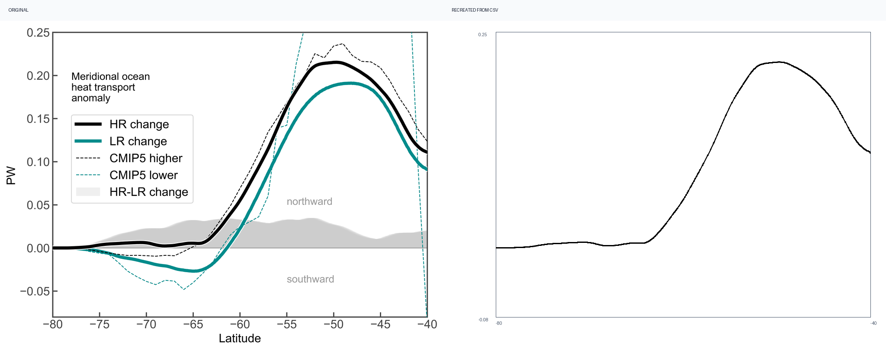

# Digitizer


[Interactive evidence gallery](https://giswlh.github.io/digitizer/) · [中文](README.md) · [Skill](SKILL.md) · [Evaluation protocol](references/benchmark.md)

Turn visible scientific figure geometry into auditable CSV. Built on **THU Digitizer**, with polygon and series-specific legend masks, JPEG chroma filtering, hollow markers and outlined-marker/curve separation.

**98.20% macro score; all 11 primary regression cases ≥90%.** This assisted development suite contains eight synthetic fixtures and three manuscript extraction tasks. Lines use a 1% y-axis-range hit rate including missing samples; scatter uses one-to-one F1 at 1% normalized distance. These are not unseen-paper or autonomous legend-detection claims.



```bash
git clone https://github.com/GISWLH/digitizer.git
cd digitizer
python3 -m venv .venv
source .venv/bin/activate
python -m pip install -e '.[dev,pdf]'
digitizer extract --config benchmarks/cases/r01/config.json --out runs/demo
python scripts/benchmark.py --ablation --require-90
```

For your own image, run `digitizer inspect`, visually review the axes, series and mask overlay, then `digitizer extract`. The agent can perform this review. Nothing is inferred beneath opaque legends. Source images stay unchanged. Every run includes CSV, original, legend mask, overlay, recreation, comparison and a hashed report.

Install the repository root as the `$digitizer` agent skill. Read [SKILL.md](SKILL.md) and [configuration](references/configuration.md) for PDF rendering, optional local OCR and supported routes.

An additional real-paper heatmap is validated separately against its author workbook: 578 numeric cells, 94 censored endpoints, MAE 0.00329. The workbook rounds values to 0.01. Raw 1% colour-range accuracy is 84.60%; the explicitly rounding-aware score is 98.79%. It does not enter the primary headline average. [Source and license](benchmarks/SOURCES.md).

Core tracing, calibration, scatter, bars and heatmaps come from [Rimagination/THU Digitizer](https://github.com/Rimagination/thu-digitizer), MIT. [Attribution and exact extensions](THIRD_PARTY_NOTICES.md). Figure/data licenses are separate from the software license.
