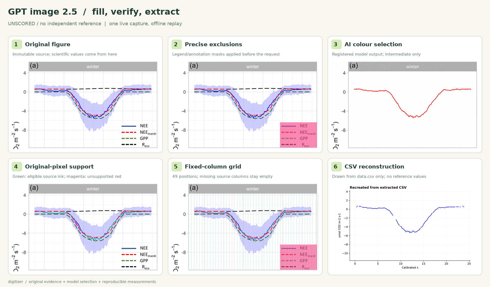
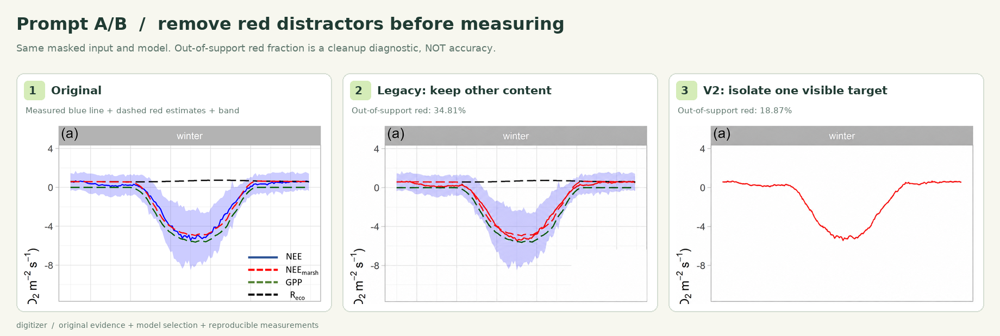
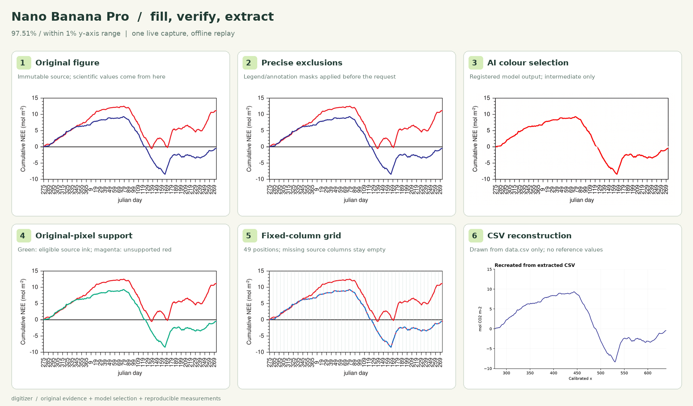
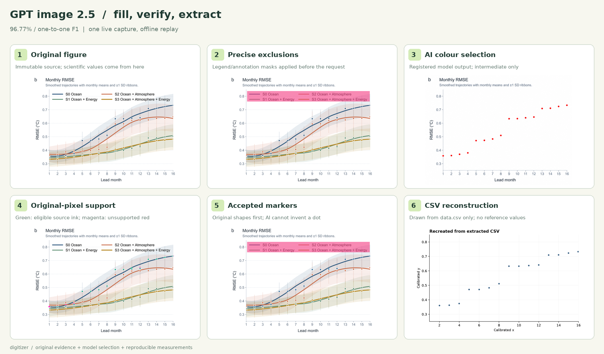
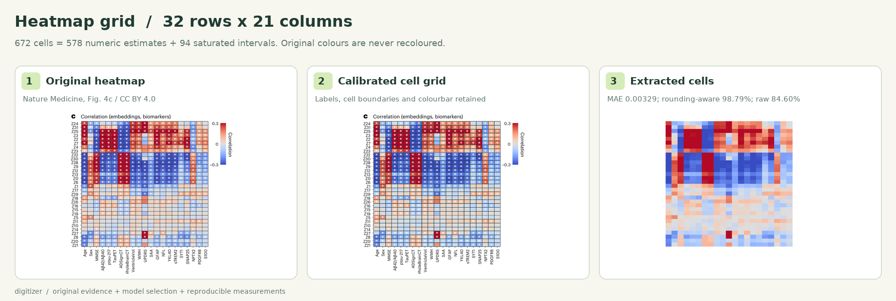

<p align="center"></p>


[简体中文](README.md) · [English](README.en.md) · [日本語](README.ja.md)

[](https://github.com/GISWLH/digitizer/actions)  

# Turn paper curves into auditable data.

**Digitizer** turns scientific figures into CSV, built on [THU Digitizer](https://github.com/Rimagination/thu-digitizer). It extends legend exclusion, preserves occluded gaps and packages the evidence as a CLI and installable agent skill.

**[→ Interactive evidence gallery](https://giswlh.github.io/digitizer/)** · [Agent skill](SKILL.md) · [Configuration](references/configuration.md)

## Core capabilities

- **Precise legend masks**: rectangles, polygons and per-series exclusions applied to extraction and residual-point checks.
- **Visible evidence only**: source images remain intact; no interpolation, generative repair or reference values fill hidden curves.
- **Complete evidence bundle**: CSV, original, masks, overlay, CSV reconstruction, comparison, uncertainty estimates and SHA-256 provenance.
- **Multiple chart types**: continuous lines, linear/log axes, filled/hollow scatter, bars and heatmaps. Calibration and series semantics require visual review.

## AI fill-and-extract: Nano Banana / GPT image 2.5

**Mask legends and clutter → colour one target red → verify original pixels → THU extraction → grid CSV.**
The integrated [paper-figure-csv-ai skill](skills/paper-figure-csv-ai/SKILL.md) includes runnable commands, versioned prompts, source/output hashes, reviewed registration and offline replay. AI supplies a selection hint; final measurements come from the original. Hidden data remain missing.



Live APIYI calls on 2026-10-13: two GPT cases plus one legacy-prompt control, and one Nano Banana case. These are **complete-pipeline scores**, alongside direct THU extraction of the same target. One successful generation per prompt is neither a model ranking nor proof that recolouring improves accuracy.

| Case | Model and target | AI-assisted result | Direct THU | Process and data |
|---|---|---:|---:|---|
| a01 · Same-colour markers and fit (manuscript) | GPT · blue marker filling | **96.77% F1**, 15/16 matches | 96.77% | [Process](docs/ai/a01/process.png) · [CSV](docs/ai/a01/data.csv) |
| a02 · Real salt-marsh NEE | GPT · separate blue line, band and estimates | **Unscored**; 759 numeric columns | 792 numeric columns | [Process](docs/ai/a02/process.png) · [Grid CSV](docs/ai/a02/grid.csv) |
| a03 · Real peat-grassland cumulative NEE | Nano Banana Pro · Stein blue line | **97.51%**, 391/401 hits | 97.51% | [Process](docs/ai/a03/process.png) · [CSV](docs/ai/a03/data.csv) |

Scatter uses one-to-one F1. Case a03 uses independent PDF paths with a tolerance of 1% of the y-axis range; missing samples count as misses. It evaluates only Stein, unlike f04's two-curve score of 95.39%. Case a02 has no independent author values; appearance and colour support are not accuracy. These cases are excluded from the original 11-case macro score.

### What changed in the prompt

The old instruction “make the target red and keep other curves and legends unchanged” retains existing red distractors. The new prompt specifies **one series, locked geometry, removal of legends and unrelated curves/bands/error bars, preserved calibration marks, and no invented hidden data**. Scatter shapes must first exist in the original, preventing AI selections from turning fragments of a fitted curve into false dots.



In this A/B with identical masked input, the registered red-pixel fraction unsupported by nearby original target colour fell from **34.81% → 18.87%**. This is a cleanup diagnostic, **not accuracy**. Final numeric columns also fell from 788 to 759; the coverage cost remains visible. [New prompt](docs/ai/a02/prompt.txt) · [Legacy prompt](docs/ai/a02/legacy-prompt.txt) · [All results](benchmarks/ai/results.json)

<details><summary>Nano Banana real-paper workflow and GPT marker-filling workflow</summary>





Nano Banana changed the output dimensions. Registration uses four measured frame landmarks, never automatic scaling based on dimensions. [Review](docs/ai/a03/review.json) · [Raw output](docs/ai/a03/generated.png) · [Request record](docs/ai/a03/request.json)

</details>

### Grid extraction: curve samples and heatmap cells

Line grids use the nearest original column at fixed x positions; missing positions remain empty, with no interpolation across occlusions. The heatmap preserves labels, colour calibration and censored intervals across **32 × 21 = 672** cells. Quantitative heatmaps are measured in their original colours, without generative recolouring.



[672-cell CSV](docs/ai/grid/grid.csv) · [49-position line grid](docs/ai/a02/grid.csv) · [Method, live calls and offline replay](references/ai-workflow.md)

```bash
python -m pip install -e '.[ai,dev,pdf]'
# Free offline replay of saved live outputs; no API call.
python scripts/validate_ai.py --require-90
digitizer grid --config benchmarks/flux/f05/config.json --columns 49 --out runs/line-grid
digitizer grid --config benchmarks/cases/p01/config.json --out runs/heatmap-grid
# ai-edit explicitly initiates paid calls for new figures; see the method guide.
```

## 8 panels from real FLUX papers

This update adds **8 panels and 12 curves from 2 papers**. These are digitization demonstrations, not new-station admissions; they do not populate the research subproject’s station output tables. NEE, respiration and partitioned photosynthesis retain separate semantics.

Seasonal salt-marsh measured NEE: extract only the blue curve, with the standard-deviation band and estimated curves retained in the original. Winter is shown below. CSV reconstructions preserve every gap.


[Original](docs/cases/f05/original.png) · [Overlay](docs/cases/f05/overlay.png) · [Mask](docs/cases/f05/legend-overlay.png) · [CSV](docs/cases/f05/data.csv)

### Cumulative NEE, two curves


**Cumulative NEE, two curves: 95.39%.** At 401 fixed positions per curve, raster extraction is compared with independent PDF vector paths. Tolerance is 1% of the y-axis range; missing samples count as misses. This measures reconstruction of plotted geometry, not raw-observation accuracy. Three dense daily panels remain below 90% and are published as challenge cases.

| Case | Validation | Score | Files |
|---|---|---:|---|
| f01 · Peat grassland · daily NEE | PDF vector paths | 52.24% · Challenge case | [CSV](docs/cases/f01/data.csv) · [JSON](docs/cases/f01/metrics.json) |
| f02 · Peat grassland · respiration | PDF vector paths | 63.84% · Challenge case | [CSV](docs/cases/f02/data.csv) · [JSON](docs/cases/f02/metrics.json) |
| f03 · Peat grassland · gross photosynthesis | PDF vector paths | 53.87% · Challenge case | [CSV](docs/cases/f03/data.csv) · [JSON](docs/cases/f03/metrics.json) |
| f04 · Peat grassland · cumulative NEE | PDF vector paths | 95.39% | [CSV](docs/cases/f04/data.csv) · [JSON](docs/cases/f04/metrics.json) |
| f05 · Salt-marsh measured NEE · winter | No independent reference | Unscored | [CSV](docs/cases/f05/data.csv) · [JSON](docs/cases/f05/metrics.json) |
| f06 · Salt-marsh measured NEE · spring | No independent reference | Unscored | [CSV](docs/cases/f06/data.csv) · [JSON](docs/cases/f06/metrics.json) |
| f07 · Salt-marsh measured NEE · summer | No independent reference | Unscored | [CSV](docs/cases/f07/data.csv) · [JSON](docs/cases/f07/metrics.json) |
| f08 · Salt-marsh measured NEE · fall | No independent reference | Unscored | [CSV](docs/cases/f08/data.csv) · [JSON](docs/cases/f08/metrics.json) |

The four seasonal salt-marsh panels are raster images. Author data are available on request, so no accuracy is assigned. Peat-grassland daily series include gap filling; Reco/GEP are partitioned estimates and are not labelled independently measured observations.

## Regression tests and independent validation

The original **11 regression tasks score 98.20% macro, with 11/11 ≥90%**: eight synthetic fixtures and three manuscript tasks with reviewed calibration. Lines use a 1% range hit rate; scatter uses one-to-one F1 at 1% normalized coordinate distance. Four simple examples were retired from the main gallery and retained as regression fixtures. This score excludes the new FLUX panels and is not a guarantee for arbitrary papers.

Separate Nature Medicine heatmap validation: 578 numeric cells and 94 censored intervals; MAE 0.00329, raw strict score **84.60%**, and **98.79%** after accounting for two-decimal reference rounding. This case is reported separately.

[Evaluation protocol](references/benchmark.md) · [FLUX protocol](references/flux-validation.md) · [Machine-readable results](benchmarks/results.json)

## Quick start

```bash
git clone https://github.com/GISWLH/digitizer.git
cd digitizer
python3 -m venv .venv
source .venv/bin/activate
python -m pip install -e '.[dev,pdf]'
digitizer extract --config benchmarks/flux/f05/config.json --out runs/demo
python scripts/validate_flux.py
python scripts/benchmark.py --ablation --require-90
python scripts/validate_paper.py
```

The example uses bundled images and needs no API key. On Windows, activate with `.venv\Scripts\activate`.

### Your own figure

```bash
digitizer inspect figure.png --plot-bounds 80,30,950,650 --out figure.json
digitizer extract --config figure.json --out runs/my-figure
```

Between these commands, review the original and proposed masks; fill axis anchors, target series and exclusions, record `review_note`, and set `reviewed: true`. Optional local OCR: `pip install ".[ocr]"`, then `inspect --ocr`. OCR only proposes candidates.

## Use as an agent skill

The repository root is the skill package. Clone it to `~/.codex/skills/digitizer` and install dependencies, or install the repository root with a skill installer.

> Use $digitizer on this paper figure. Review axes, series and legend masks; export CSV and comparison images. Leave occluded data missing, distinguish measured from estimated quantities, and report no accuracy without an independent reference.

## Support and limitations

| Input / chart | Support |
|---|---|
| PNG / JPEG / PDF panels | Render PDFs first, then review calibration |
| Lines / scatter | Visible-pixel tracing; fully overlapping or hidden data cannot be recovered |
| Bars / heatmaps | Inherited THU routes; bars support global rectangular exclusions only, saturated heatmap endpoints remain intervals |
| Automation | Human or agent visual review; not an unsupervised zero-review extractor |

`extraction_error` estimates pixel/calibration uncertainty; it is not measured accuracy. Complex daily series still have substantial errors, documented in public challenge cases.

## Contribute

Contribute real paper figures and independent references to improve dense crossings and same-colour series separation.

[Contributing](CONTRIBUTING.md) · [Roadmap](ROADMAP.md) · [Changelog](CHANGELOG.md) · [Submit a figure](https://github.com/GISWLH/digitizer/issues/new?template=figure.yml)

## Visual identity

The banner and logo are drawn in **Excalidraw 0.18.1**, with SVG, PNG and editable scenes. The banner’s numbers are schematic, not experimental results.

[Banner source](docs/assets/banner.excalidraw) · [Logo source](docs/assets/icon.excalidraw) · [Design workflow](design/README.md)

## Sources, licenses and citation

Software is MIT; the core digitization engines come from THU Digitizer. Figure licenses are separate: Mayen et al. (2024), CC BY 4.0; Veenendaal et al. (2007) figures and adapted evidence, **CC BY-NC-SA 2.5**, not the software’s MIT license. Cite both the software and the papers you use.

[Figure provenance](benchmarks/SOURCES.md) · [THU attribution](THIRD_PARTY_NOTICES.md) · [CITATION.cff](CITATION.cff)
