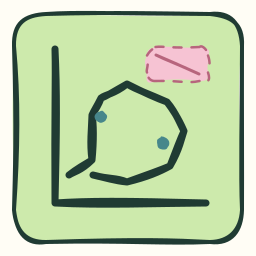
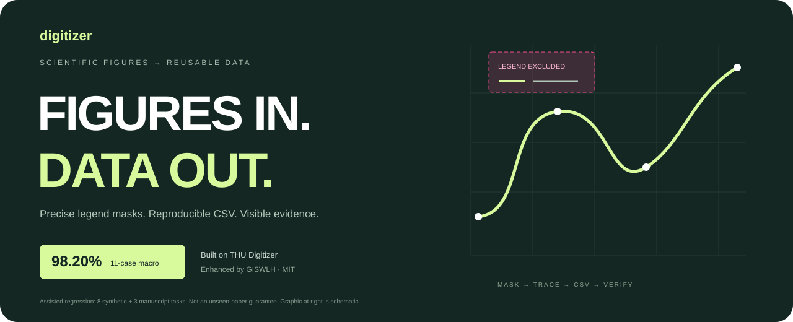
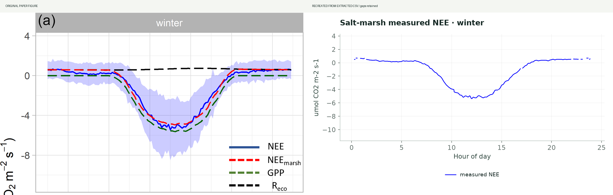
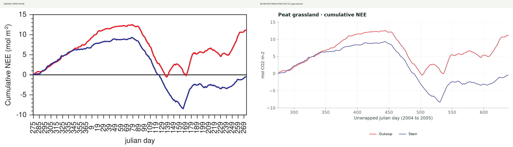

<p align="center"></p>



[简体中文](README.md) · [English](README.en.md) · [日本語](README.ja.md)

[](https://github.com/GISWLH/digitizer/actions)  

# 論文の曲線を、検証できるデータへ。

**Digitizer** は [THU Digitizer](https://github.com/Rimagination/thu-digitizer) を基盤に、科学論文の図を CSV に変換します。凡例の除外、遮蔽部分の欠損保持、検証資料の出力を強化し、CLI とインストール可能なエージェントスキルを提供します。

**[→ 対話型事例ギャラリー](https://giswlh.github.io/digitizer/)** · [Agent skill](SKILL.md) · [Configuration](references/configuration.md)

## 主な機能

- **精密な凡例マスク**：矩形、多角形、系列別の除外領域を、抽出処理と残存点の検査の両方に適用します。
- **見えている情報だけを抽出**：原図は変更せず、補間・生成画像・参照値で隠れた曲線を埋めません。
- **検証資料を一括出力**：CSV、原図、マスク、重ね合わせ図、CSV からの再描画、比較図、不確かさの推定値、SHA-256 による出典記録。
- **複数の図形式に対応**：折れ線、線形・対数軸、塗りつぶし・中空マーカーの散布図、棒グラフ、ヒートマップ。軸の校正と系列の意味は目視で確認します。

## 実際の FLUX 論文から 8 パネルを追加

今回、**2 編の論文から 8 パネル・12 本の曲線**を追加しました。デジタイズの実例であり、新規観測地点として登録するものではありません。研究サブプロジェクトの地点別成果表には追加しません。NEE、呼吸、分離推定された光合成量の意味を区別して記録します。

塩性湿地の四季の実測 NEE：青線のみを抽出し、標準偏差の帯と推定曲線は原図の情報として残します。以下は冬季の例です。CSV からの再描画でも欠損を保持します。



[Original](docs/cases/f05/original.png) · [Overlay](docs/cases/f05/overlay.png) · [Mask](docs/cases/f05/legend-overlay.png) · [CSV](docs/cases/f05/data.csv)

### 累積 NEE の 2 曲線



**累積 NEE の 2 曲線：95.39%。** 各曲線の固定 401 点で、画像からの抽出結果を独立した PDF ベクトルパスと比較します。許容誤差は y 軸範囲の 1% とし、欠損は不一致に数えます。これは描かれた図形の再現精度であり、元の観測値の精度ではありません。密な日別系列の 3 パネルは 90% 未満であり、難易度の高い事例として公開しています。

| 事例 | 検証方法 | スコア | ファイル |
|---|---|---:|---|
| f01 · 泥炭草地の日別 NEE | PDF のベクトルパス | 52.24% · 難易度の高い事例 | [CSV](docs/cases/f01/data.csv) · [JSON](docs/cases/f01/metrics.json) |
| f02 · 泥炭草地の生態系呼吸 | PDF のベクトルパス | 63.84% · 難易度の高い事例 | [CSV](docs/cases/f02/data.csv) · [JSON](docs/cases/f02/metrics.json) |
| f03 · 泥炭草地の総生態系光合成 | PDF のベクトルパス | 53.87% · 難易度の高い事例 | [CSV](docs/cases/f03/data.csv) · [JSON](docs/cases/f03/metrics.json) |
| f04 · 泥炭草地の累積炭素交換 | PDF のベクトルパス | 95.39% | [CSV](docs/cases/f04/data.csv) · [JSON](docs/cases/f04/metrics.json) |
| f05 · 塩性湿地の実測 NEE · 冬季 | 独立した参照値なし | 未評価 | [CSV](docs/cases/f05/data.csv) · [JSON](docs/cases/f05/metrics.json) |
| f06 · 塩性湿地の実測 NEE · 春季 | 独立した参照値なし | 未評価 | [CSV](docs/cases/f06/data.csv) · [JSON](docs/cases/f06/metrics.json) |
| f07 · 塩性湿地の実測 NEE · 夏季 | 独立した参照値なし | 未評価 | [CSV](docs/cases/f07/data.csv) · [JSON](docs/cases/f07/metrics.json) |
| f08 · 塩性湿地の実測 NEE · 秋季 | 独立した参照値なし | 未評価 | [CSV](docs/cases/f08/data.csv) · [JSON](docs/cases/f08/metrics.json) |

塩性湿地の四季の図はラスター画像です。著者の元データは依頼による提供のため、精度は報告していません。泥炭草地の日別系列には欠測補完が含まれ、Reco/GEP は分離推定量です。独立して直接測定された観測量とは区別します。

## 回帰テストと独立検証

従来の **11 タスクのマクロ平均は 98.20%、11/11 が 90% 以上**です。内訳は合成図 8 件と書籍原稿の 3 タスクで、校正は目視確認済みです。折れ線は軸範囲 1% の一致率、散布図は正規化座標距離 1% の一対一対応による F1 を使用します。単純な 4 例は主ギャラリーから外し、回帰テスト用に保持しました。このスコアに新しい FLUX パネルは含まれず、任意の論文に対する保証でもありません。

Nature Medicine のヒートマップは別途検証しています。数値セル 578 個、飽和区間 94 個、MAE 0.00329。厳密な元スコアは **84.60%**、参照値の小数第 2 位への丸めを考慮すると **98.79%** です。この事例は個別に報告します。

[評価プロトコル](references/benchmark.md) · [FLUX protocol](references/flux-validation.md) · [機械可読の結果](benchmarks/results.json)

## クイックスタート

```bash
git clone https://github.com/GISWLH/digitizer.git
cd digitizer
python3 -m venv .venv
source .venv/bin/activate
python -m pip install -e '.[dev,pdf]'
digitizer extract --config benchmarks/flux/f05/config.json --out runs/demo
python scripts/validate_flux.py
python scripts/benchmark.py --ablation --require-90
python scripts/validate_paper.py
```

同梱画像を使うため API キーは不要です。Windows での有効化は `.venv\Scripts\activate` です。

### 自分の図を処理する

```bash
digitizer inspect figure.png --plot-bounds 80,30,950,650 --out figure.json
digitizer extract --config figure.json --out runs/my-figure
```

2 つのコマンドの間に、原図とマスク候補を確認し、軸の基準点・対象系列・除外領域を設定します。`review_note` に確認内容を記録し、`reviewed: true` にします。任意のローカル OCR は `pip install ".[ocr]"` 後に `inspect --ocr` で使用できます。OCR は候補の提示のみを行います。

## エージェントスキルとして使う

リポジトリのルートがスキルパッケージです。`~/.codex/skills/digitizer` にクローンして依存関係をインストールするか、スキルインストーラーでリポジトリのルートを指定します。

> $digitizer でこの論文図を抽出してください。軸、系列、凡例マスクを確認し、CSV と比較図を出力してください。遮蔽部分は欠損のままにし、実測量と推定量を区別してください。独立した参照値がなければ精度を報告しないでください。

## 対応範囲と制約

| 入力・図形式 | 対応状況 |
|---|---|
| PNG / JPEG / PDF のパネル | PDF は画像化した後に校正を確認 |
| 折れ線・散布図 | 可視画素を追跡。完全に重なった点や隠れたデータは復元不可 |
| 棒グラフ・ヒートマップ | THU の処理を継承。棒グラフの除外は全系列共通の矩形のみ、飽和した色端点は区間として保持 |
| 自動化の範囲 | 人またはエージェントによる目視確認が必要 |

`extraction_error` は画素・校正に由来する不確かさの推定であり、測定された精度ではありません。複雑な日別系列には依然として大きな誤差があり、公開事例に記録しています。

## プロジェクトへの参加

密な交差や同色系列の分離を改善するため、実際の論文図と独立した参照値の提供を歓迎します。

[Contributing](CONTRIBUTING.md) · [Roadmap](ROADMAP.md) · [Changelog](CHANGELOG.md) · [Submit a figure](https://github.com/GISWLH/digitizer/issues/new?template=figure.yml)

## ビジュアル素材

ヘッダー画像とロゴは **Excalidraw 0.18.1** の手描きスタイルで作成し、SVG、PNG、編集可能なシーンを提供しています。ヘッダー画像の数値は説明用で、実験結果ではありません。

[Banner source](docs/assets/banner.excalidraw) · [Logo source](docs/assets/icon.excalidraw) · [Design workflow](design/README.md)

## 出典・ライセンス・引用

ソフトウェアは MIT ライセンスで、主要なデジタイズ機能は THU Digitizer に由来します。図のライセンスは別です。Mayen et al. (2024) は CC BY 4.0、Veenendaal et al. (2007) の図とその改変資料は **CC BY-NC-SA 2.5** で、ソフトウェアの MIT は適用されません。利用時はソフトウェアと該当論文の両方を引用してください。

[Figure provenance](benchmarks/SOURCES.md) · [THU attribution](THIRD_PARTY_NOTICES.md) · [CITATION.cff](CITATION.cff)
