<p align="center"><a href="https://giswlh.github.io/digitizer/"></a></p>

<p align="center"><a href="https://giswlh.github.io/digitizer/">交互案例画廊</a> · <a href="#快速开始">快速开始</a> · <a href="SKILL.md">Agent 技能</a> · <a href="references/benchmark.md">测试协议</a> · <a href="README.en.md">English</a></p>
<p align="center">   <a href="https://github.com/GISWLH/digitizer/actions"></a></p>

# 图例退场，数据登场。

**Digitizer** 把科研论文中的可见图表数据数字化为 CSV。它以 [THU Digitizer](https://github.com/Rimagination/thu-digitizer) 为核心，增强复杂图例的精细排除、低清图处理和混合标记识别，并打包为可安装的 Agent 技能。

**原有 11 个案例全部 ≥90%，宏平均分 98.20%，最低 93.52%。** 这是人工复核校准后的开发回归结果：8 个合成图、3 个书稿面板任务；折线使用误差阈值命中率，散点使用 F1。不是对任意论文或全自动图例识别的保证。

## 为什么关注图例？

图例中的线段和圆点，往往与真实数据同色同形。删除整个角落会误删数据，完全忽略图例又会制造假点。

- **精细排除**：矩形、多边形、按系列生效的遮罩，在主提取和残余点检查中一致生效。
- **忠于可见证据**：保留原图；遮挡区留空；不通过生成式补图、插值或作者数据补齐曲线。
- **THU 核心增强**：连续路径追踪、线性/对数校准、填充散点；新增空心环与独立描边标记路线。
- **完整交付**：CSV、原图、遮罩、提取覆盖、重绘、并排对比和带 SHA-256 的 JSON 报告。

## 看得见的提取结果

粉色区域是被排除的图例/注释，蓝色标记是提取位置。所有重绘均来自本次提取值。点击图片可看大图。

### 海洋热输送 × 图例与注释 · 100.00%

| 原图 | 提取覆盖 | CSV 重绘 |
|---|---|---|
| 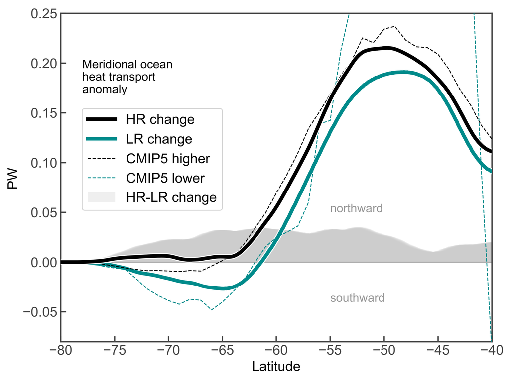 | 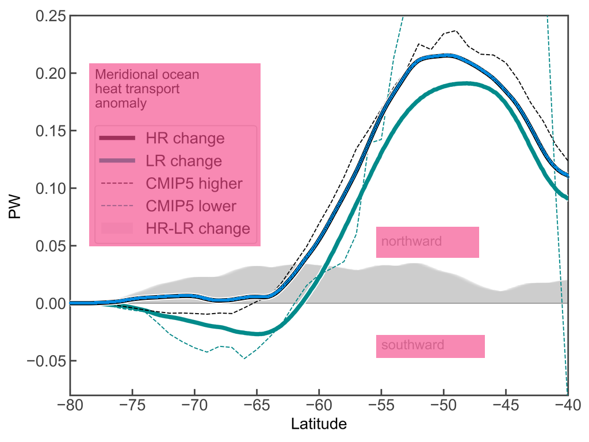 | 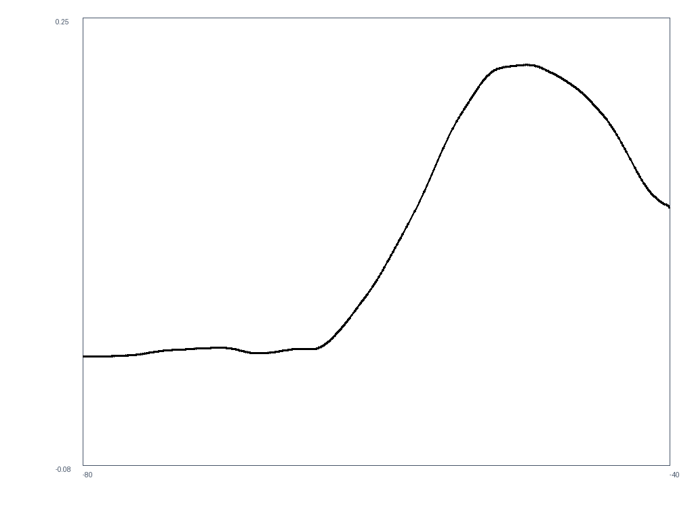 |

[查看高清并排对比](docs/cases/r01/comparison.png) · [下载 CSV](docs/cases/r01/data.csv) · [图例遮罩](docs/cases/r01/legend-overlay.png)

### 同色交叉线 × 内嵌图例 · 100.00%

| 原图 | 提取覆盖 | CSV 重绘 |
|---|---|---|
| 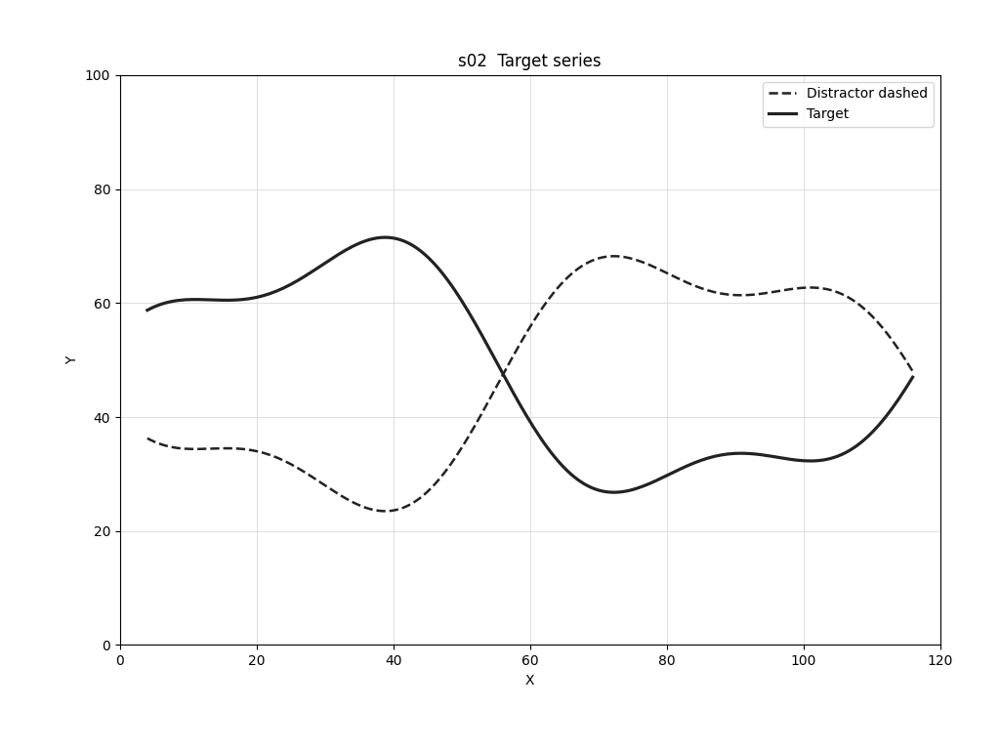 | 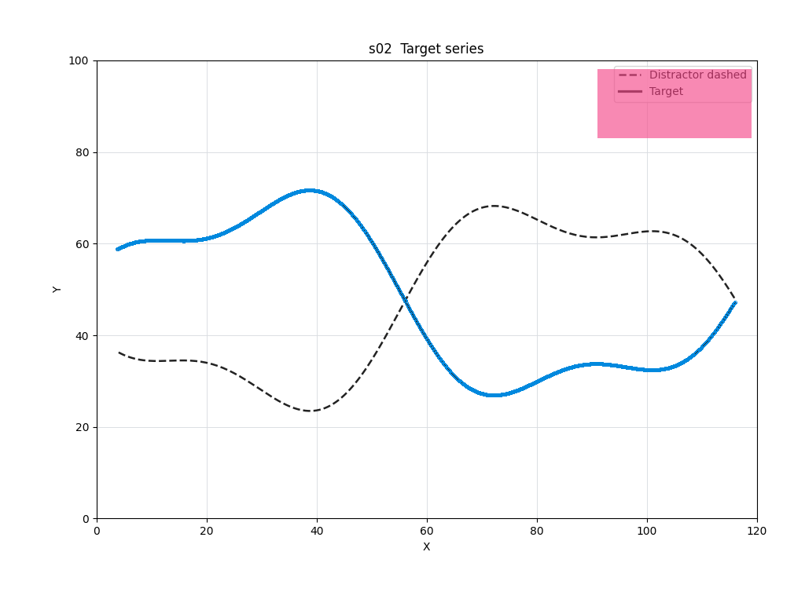 | 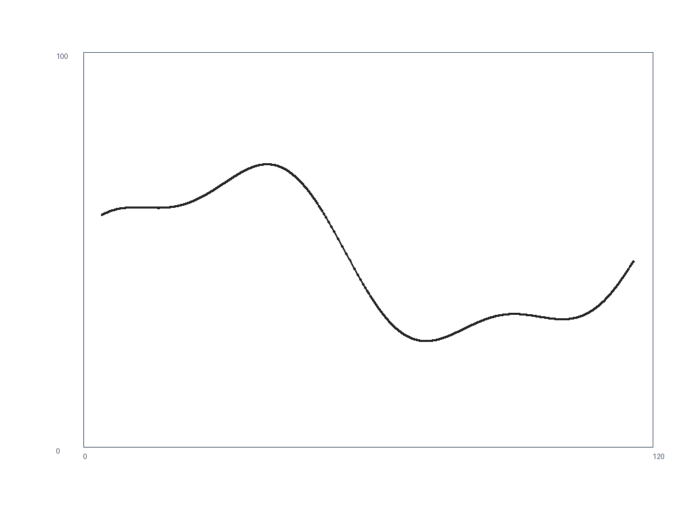 |

[查看高清并排对比](docs/cases/s02/comparison.png) · [下载 CSV](docs/cases/s02/data.csv) · [图例遮罩](docs/cases/s02/legend-overlay.png)

### 同色散点 × 拟合曲线 · 96.77%

| 原图 | 提取覆盖 | CSV 重绘 |
|---|---|---|
| 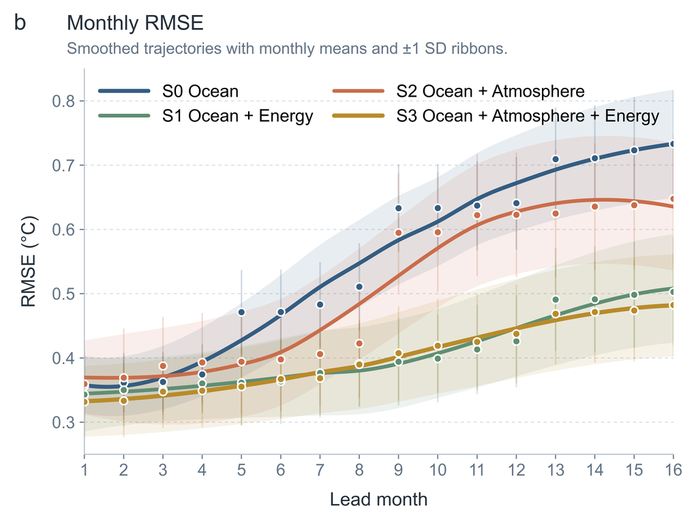 | 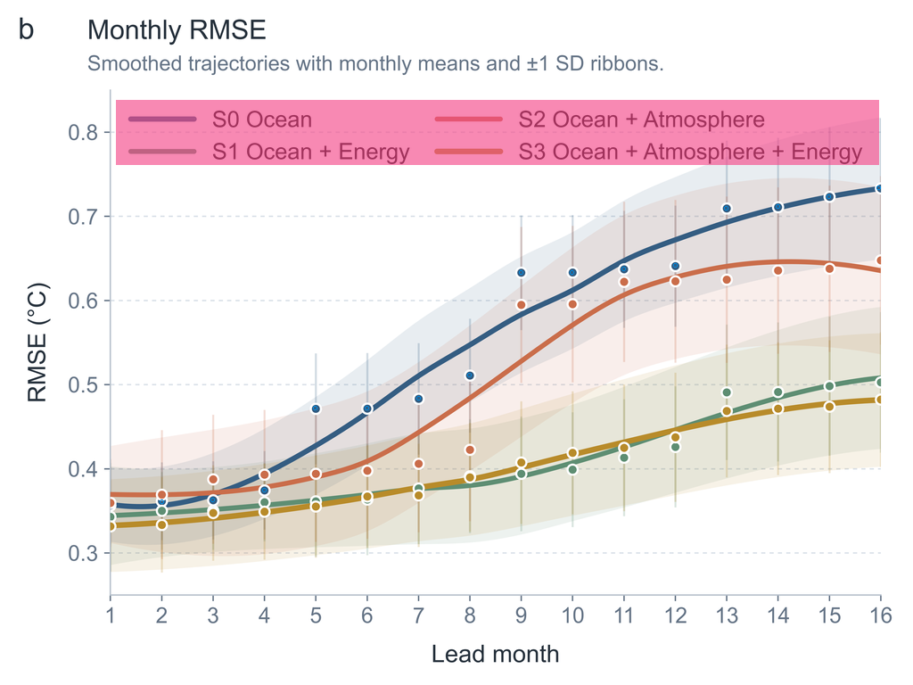 | 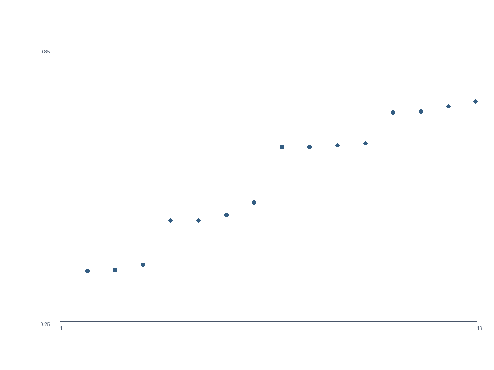 |

[查看高清并排对比](docs/cases/r03/comparison.png) · [下载 CSV](docs/cases/r03/data.csv) · [图例遮罩](docs/cases/r03/legend-overlay.png)

### 低清 JPEG × 压缩伪影 · 96.78%

| 原图 | 提取覆盖 | CSV 重绘 |
|---|---|---|
| 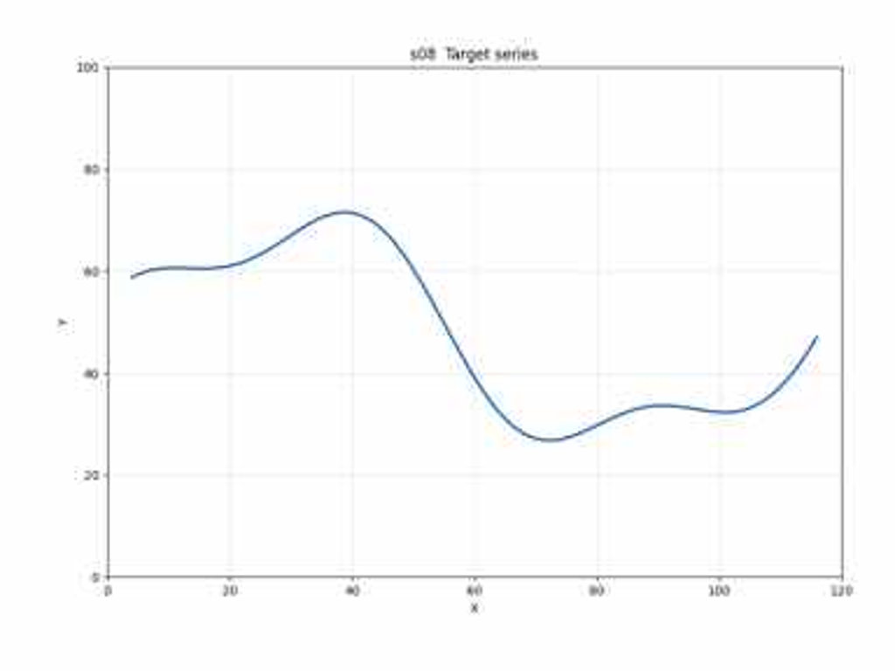 | 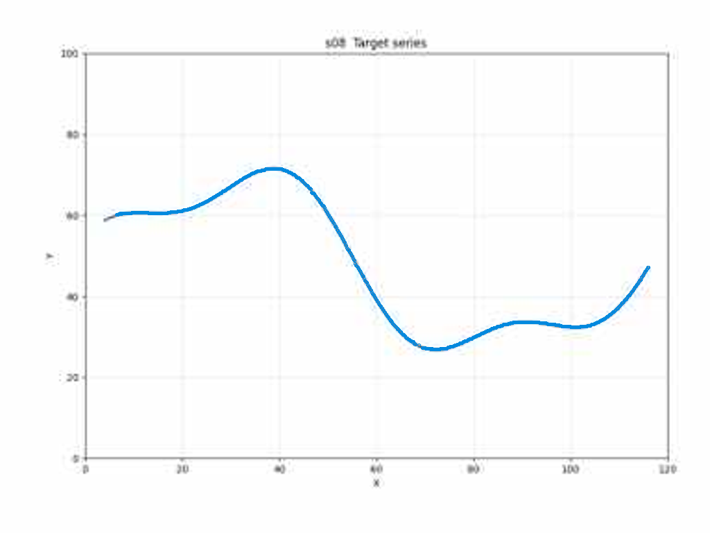 | 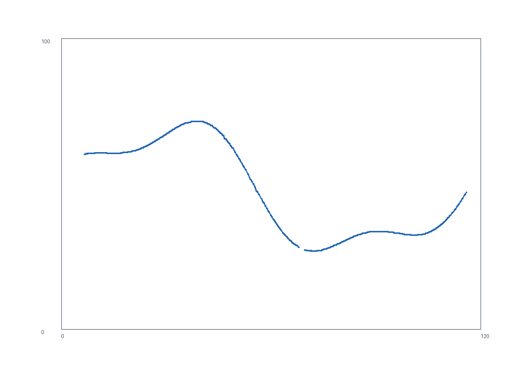 |

[查看高清并排对比](docs/cases/s08/comparison.png) · [下载 CSV](docs/cases/s08/data.csv) · [图例遮罩](docs/cases/s08/legend-overlay.png)


## 全量测试结果

| 案例 | 指标 | 分数 | 覆盖率 / 召回率 | 证据 |
|---|---|---:|---:|---|
| [s01 · 清晰彩色折线](docs/cases/s01/comparison.png) | 折线 ≤1% 量程 | **100.00%** | 100.00% | [CSV](docs/cases/s01/data.csv) · [指标](docs/cases/s01/metrics.json) |
| [s02 · 同色交叉线 × 内嵌图例](docs/cases/s02/comparison.png) | 折线 ≤1% 量程 | **100.00%** | 100.00% | [CSV](docs/cases/s02/data.csv) · [指标](docs/cases/s02/metrics.json) |
| [s03 · 阶梯线 × 不可见遮挡](docs/cases/s03/comparison.png) | 折线 ≤1% 量程 | **97.17%** | 97.17% | [CSV](docs/cases/s03/data.csv) · [指标](docs/cases/s03/metrics.json) |
| [s04 · 对数坐标曲线](docs/cases/s04/comparison.png) | 折线 ≤1% 量程 | **100.00%** | 100.00% | [CSV](docs/cases/s04/data.csv) · [指标](docs/cases/s04/metrics.json) |
| [s05 · 稀疏实心散点](docs/cases/s05/comparison.png) | 散点 F1 @1% | **100.00%** | 100.00% | [CSV](docs/cases/s05/data.csv) · [指标](docs/cases/s05/metrics.json) |
| [s06 · 密集重叠散点](docs/cases/s06/comparison.png) | 散点 F1 @1% | **95.95%** | 92.22% | [CSV](docs/cases/s06/data.csv) · [指标](docs/cases/s06/metrics.json) |
| [s07 · 空心标记 × 网格](docs/cases/s07/comparison.png) | 散点 F1 @1% | **100.00%** | 100.00% | [CSV](docs/cases/s07/data.csv) · [指标](docs/cases/s07/metrics.json) |
| [s08 · 低清 JPEG × 压缩伪影](docs/cases/s08/comparison.png) | 折线 ≤1% 量程 | **96.78%** | 96.78% | [CSV](docs/cases/s08/data.csv) · [指标](docs/cases/s08/metrics.json) |
| [r01 · 海洋热输送 × 图例与注释](docs/cases/r01/comparison.png) | 折线 ≤1% 量程 | **100.00%** | 100.00% | [CSV](docs/cases/r01/data.csv) · [指标](docs/cases/r01/metrics.json) |
| [r02 · 多系列曲线 × 置信带](docs/cases/r02/comparison.png) | 折线 ≤1% 量程 | **93.52%** | 95.51% | [CSV](docs/cases/r02/data.csv) · [指标](docs/cases/r02/metrics.json) |
| [r03 · 同色散点 × 拟合曲线](docs/cases/r03/comparison.png) | 散点 F1 @1% | **96.77%** | 93.75% | [CSV](docs/cases/r03/data.csv) · [指标](docs/cases/r03/metrics.json) |

折线：固定 401 个 x 采样位置，误差 ≤ y 轴量程 1%，漏点计为未命中。散点：归一化坐标距离阈值 1% 的一对一匹配 F1，同时惩罚漏点和误检。阈值、缺失与遮挡规则见[完整协议](references/benchmark.md)，[机器可读结果](benchmarks/results.json)保留每个分母及输入哈希。

### 真实论文：与作者数据独立比较

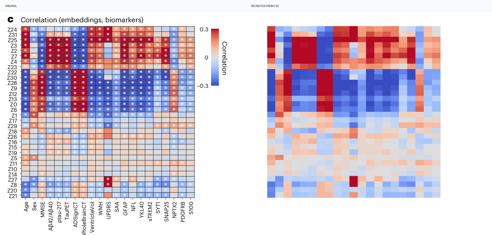

Nature Medicine Fig. 4c：**672** 个可见单元，**578** 个数值颜色和 **94** 个饱和区间。对作者两位小数参考值，MAE 为 **0.00329**；考虑 ±0.005 参考舍入区间后的 1% 色标容差命中率 **98.79%**，未经舍入调整的严格分数为 **84.60%**。94 个饱和区间全部与参考相容。此案例单独报告，不进入 11 案例宏平均。

[论文及许可](benchmarks/SOURCES.md) · [独立评分](docs/cases/p01/metrics.json) · [CSV](docs/cases/p01/data.csv) · [逐单元对比](docs/cases/p01/source-comparison.csv)

## 快速开始

```bash
git clone https://github.com/GISWLH/digitizer.git
cd digitizer
python3 -m venv .venv
source .venv/bin/activate  # Windows: .venv\Scripts\activate
python -m pip install -e '.[dev,pdf]'

# 立即运行包含图例的真实本地案例
digitizer extract --config benchmarks/cases/r01/config.json --out runs/demo

# 重现全部主测试（每个案例都必须 ≥90%）
python scripts/benchmark.py --ablation --require-90
python scripts/validate_paper.py
```

处理自己的图片：

```bash
digitizer inspect figure.png --plot-bounds 80,30,950,650 --out figure.json
# 由 Agent 查看原图和 overlay，填写坐标锚点、系列和图例遮罩并确认 reviewed。
digitizer extract --config figure.json --out runs/my-figure
```

可选本地 OCR：`python -m pip install '.[ocr]'`，然后使用 `inspect --ocr`。OCR 只提出候选，视觉复核决定遮罩。无需任何远程 API Key。

## 作为独立技能使用

仓库根目录就是技能包，包含 `SKILL.md`、`agents/openai.yaml`、可执行引擎和参考协议。将仓库安装到 Agent 的 skills 目录后，可直接请求：

> 用 $digitizer 提取这张论文图。先核验坐标轴、数据系列和图例遮罩；导出 CSV，展示原图、提取覆盖、重绘与并排对比。被遮挡的数据保持缺失。

Codex 示例：克隆到 `~/.codex/skills/digitizer`，在该目录创建虚拟环境并按上面的命令安装依赖。也可让 Agent 的 skill installer 安装此仓库根目录。

## 边界与来源

坐标轴、面板边界和系列语义需要视觉复核。全遮挡、完全重合、未知非线性投影等情况不能可靠恢复。CSV 的 `extraction_error` 是像素与校准误差估计，不是作者真值误差。热图饱和端点保留区间；未通过残余检查的散点保留未授权状态。

THU 已提供本项目依赖的主要数字化能力，原工作区也已有矩形图例排除。我们的增量与修改文件在 [THIRD_PARTY_NOTICES.md](THIRD_PARTY_NOTICES.md) 中列明。软件沿用 MIT 许可；论文图件与作者数据保留各自许可。感谢 [Rimagination / THU Digitizer](https://github.com/Rimagination/thu-digitizer)。
